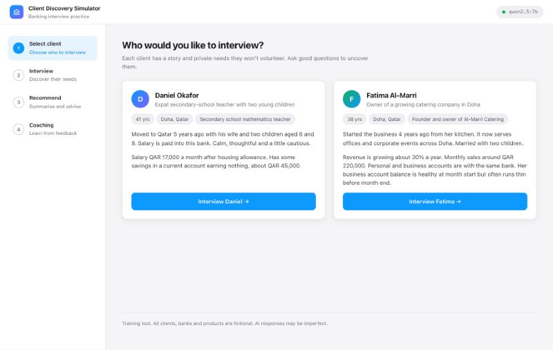
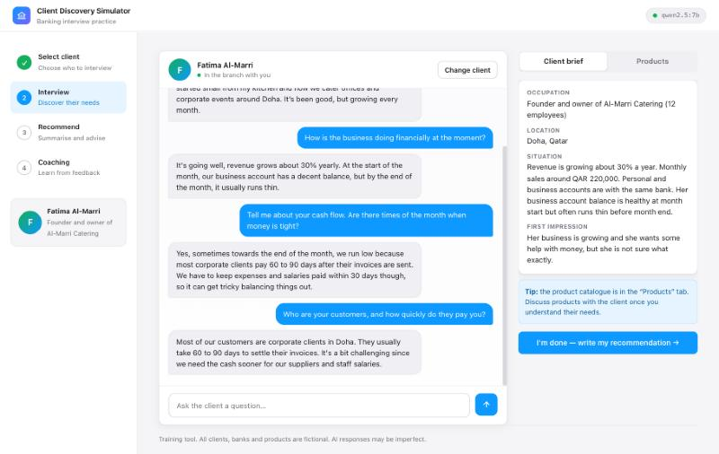
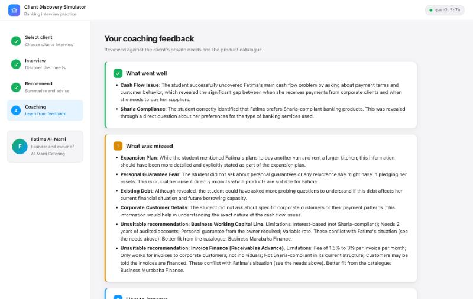
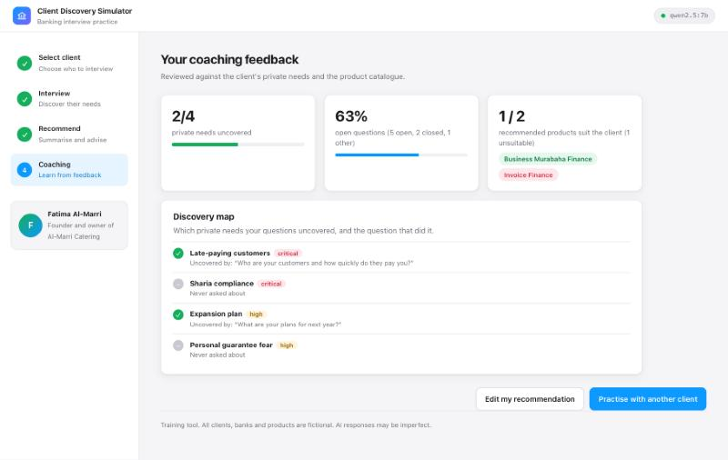
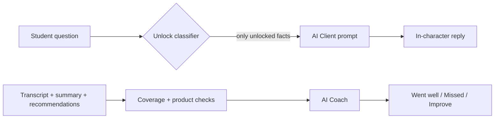

# Bank Client Discovery Simulator

Practise interviewing bank clients, uncovering their financial needs and recommending suitable products.
A student chats with an **AI Client** who keeps private needs hidden until asked the right questions, then receives
learning-focused feedback from an **AI Coach**.

**Select client → Interview → Recommend → Coaching feedback**

| 1. Select a client | 2. Interview | 3. Coaching feedback |
|---|---|---|
|  |  |  |



## What makes this different

1. **Hidden facts are locked, not just "requested to stay hidden".** A classifier unlocks a fact only when the student asks
   about it; locked facts never enter the client's prompt, so even a small model cannot blurt them out.
   Measured with `scripts/evaluate.py` (results below); the barrier itself is proven by offline tests.
2. **A live "Discovered" board** shows how many private needs the student has uncovered so far, without revealing what the
   missing ones are.
3. **Evidence-based coaching.** After the interview the student sees a *discovery map* (which need was uncovered by which
   question), questioning-technique stats (open vs closed questions) and a check of each recommended product against the
   client's needs. These are computed in code, so they are always correct; the AI Coach then writes the advice on top of them.
4. **Tested.** 13 offline unit tests cover content integrity, the leak barrier and the analytics; an evaluation script
   measures the AI itself.

- Python 3.9+ **standard library only**: no `pip install`, no database, no login.
- Both AIs use any **OpenAI-compatible** `/chat/completions` API (Ollama, LM Studio, Groq, OpenRouter, OpenAI...).
- Clients, products and prompts are plain files you can edit without touching code.

## Quick start

```bash
git clone https://github.com/mdmumtaz7480-eng/bank-client-discovery-simulator.git
cd bank-client-discovery-simulator
cp .env.example .env        # then edit .env if you use a different model
python3 app.py
```
Open **http://localhost:8000**.

### Free local model (what I used)
```bash
ollama pull qwen2.5:7b      # ~4.7 GB, runs on a 16 GB laptop
ollama serve                # skip if the Ollama app is already running
```
The default `.env.example` already points at it.

## Configure the AI connection (`.env`)

| Variable | Meaning | Example |
|---|---|---|
| `AI_BASE_URL` | OpenAI-compatible base URL (ends in `/v1`) | `http://localhost:11434/v1` |
| `AI_API_KEY` | API key (any text for local models) | `ollama` |
| `AI_MODEL` | Model name | `qwen2.5:7b` |
| `AI_TEMPERATURE` | Optional, client creativity | `0.7` |
| `PORT` | Optional web port | `8000` |

Hosted free options (Groq, OpenRouter) are listed as examples in `.env.example`. Real environment variables override `.env`.

**Tested with:** Ollama running **`qwen2.5:7b`** (free, open-source, local) via `http://localhost:11434/v1`.

## How the AI is used



- **AI Client**: a small classifier call decides which hidden facts each student question has *unlocked*. Only those facts are
  placed in the client's prompt, so a small model cannot leak the rest. The prompt adds character, personality and rules
  (stay in role, short natural replies, react to product proposals based on the client's values and finances).
- **AI Coach**: receives the client file, hidden needs, product limitations, transcript and the student's own summary
  and recommendations. Code first computes a *coverage checklist* (which hidden needs were revealed) and flags *unsuitable
  recommended products*, then the model writes feedback under **What went well / What was missed / How to improve**, with no score.

## Tests and evaluation

```bash
python3 -m unittest discover -s tests      # 13 offline tests, no model needed
python3 scripts/evaluate.py --baseline     # leak / reveal evaluation, compares against a prompt-only client
```
Results on `qwen2.5:7b` (details and caveats in [`docs/evaluation.md`](docs/evaluation.md)):

| Mode | Opening replies leaking a hidden fact | Hidden facts revealed when asked |
|---|---|---|
| Gated (this app) | 0 / 12 | 6 / 11 (strict keyword match; most misses were the right fact in different words) |
| Prompt-only baseline | 1 / 12 | 7 / 11 |

Small sample, one trial each: treat these as a measured starting point, not a benchmark.

## Editing the content (no code changes)

| File | Purpose |
|---|---|
| `content/clients/*.json` | One file per client: public profile, hidden information (with evaluation `keywords` and a `probe` question), ideal needs, suitable/unsuitable products. Add a file to add a client. |
| `content/products.json` | Product catalogue with features and limitations. |
| `content/prompts.json` | AI Client and AI Coach instructions. |

Files are re-read on every request, so edits apply immediately. Included: **2 clients** (Fatima, a Doha catering owner; Daniel, an expat teacher) and **7 products**.

## Sample interview

[`samples/sample-interview.md`](samples/sample-interview.md) contains the full conversation, the student's summary and
product recommendations, and the AI Coach feedback. Regenerate it with your own model:
```bash
python3 scripts/generate_sample.py
```

## Project structure

```
app.py                 web server + both AI roles (stdlib only)
static/                web interface (HTML, CSS, JS)
content/               clients, products, prompts (editable)
samples/               sample interview
scripts/               sample generator and evaluation
tests/                 offline unit tests
docs/                  screenshots
```

## Limitations

A 7B local model sometimes gives imperfect coaching wording or small role-play slips; a larger model through the same `.env`
settings improves quality. This is a prototype: no authentication, persistence or production hardening.

Licensed under the MIT License.
